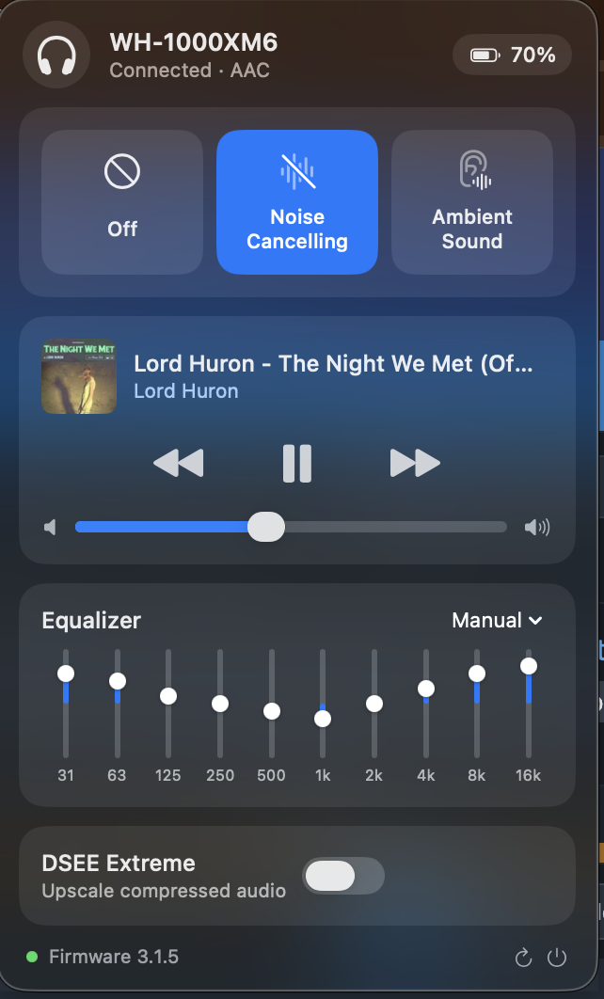

# Hush

[](https://github.com/ismoilovdevml/hush/actions/workflows/build.yml)

Menu bar control for Sony WH-1000XM6 headphones on macOS.

Sony's Sound Connect app is iPhone-only, so on a Mac there is no way to change noise
cancelling, read the battery or toggle DSEE. Hush talks to the headphones directly over
Bluetooth RFCOMM using Sony's own MDR protocol.



## What it does

- **Noise cancelling** — Off / Noise Cancelling / Ambient Sound, ambient level 0–20, Focus on Voice
- **Battery**, active **codec**, **firmware version**
- **Equalizer** — 10 bands from 31 Hz to 16 kHz at ±6 dB, plus the presets the headphones
  themselves report (Off, Heavy, Clear, Hard, Soft, Gaming, Manual, User 1, User 2)
- **DSEE Extreme** toggle
- **Now Playing** — artwork, title, artist, and transport that works with any player, browsers included
- **Volume**, kept in step with the system volume

No Dock icon, no login item, no network access.

## Requirements

- Apple Silicon Mac, macOS 14 or later
- Headphones paired and connected in macOS Bluetooth
- Xcode command line tools to build (`xcode-select --install`)

Built and verified against a WH-1000XM6 on firmware 3.1.5. Other Sony headsets that speak
MDR protocol v2 (XM4, XM5, LinkBuds) may work, but none has been tested.

## Install

```sh
git clone https://github.com/ismoilovdevml/hush.git
cd hush
./build.sh install
open ~/Applications/Hush.app
```

`./build.sh` alone builds to `build/Hush.app` without installing. A prebuilt
`Hush.app.zip` is attached to every tagged release.

The app is ad-hoc signed, so macOS will warn the first time: right-click → Open.

## How it works

### Finding the channel

The headphones advertise 23 SDP service records. The one that matters is Sony's control
service, UUID `956c7b26-d49a-4ba8-b03f-b17d393cb6e2`, on **RFCOMM channel 9**. macOS can
open it with `IOBluetoothDevice.openRFCOMMChannelSync` while the headset is connected for
audio — no extra permission is needed.

### Frame format

```
0x3E | dataType | seq | length (4B, big endian) | payload | checksum | 0x3C
```

`checksum` is the sum of every byte from `dataType` through the payload, masked to 8 bits.
Inside the frame, the bytes `0x3E`, `0x3C` and `0x3D` are escaped as `0x3D` followed by
`b & 0xEF` — bit 4 cleared, not bit 5 — and the reader restores them with `b | 0x10`.

Getting that mask wrong is easy and stays invisible for a long time, because most payloads
never contain those three bytes. It first showed up here in the equalizer band table, where
16000 Hz is `0x3E80`: the frame decoded one byte short of correct and its checksum failed.
Frames that fail the checksum are dropped rather than passed on.

Two rules are easy to miss and break everything if you get them wrong:

1. **Every received frame must be acknowledged** with `dataType 0x01` and
   `seq = 1 - received_seq`, or the headset retransmits the same frame about five times.
2. **The link is strictly request/response.** The sequence bit flips on each exchange, so
   sending several commands at once makes all but the first disappear. `SonyLink` keeps a
   queue with exactly one request in flight.

### Ambient sound control on the XM6

Gadgetbridge sends the ambient-sound inquiry with sub-type `0x15` (or `0x17` on devices
with wind noise reduction). On the WH-1000XM6 **neither works**: `0x15` and `0x22` get no
reply at all, and `0x17` answers once with a stale all-zero payload that never tracks the
real state. The sub-type that actually round-trips is **`0x19`**:

```
GET     0x66 0x19
RET     0x67 0x19 0x01 <on> <ambient> <focusOnVoice> <level> 0x00 0x00
SET     0x68 0x19 0x01 <on> <ambient> <focusOnVoice> <level>
NOTIFY  0x69 0x19 ...                       (echoes the new state)
```

`on=0` is Off, `on=1, ambient=0` is Noise Cancelling, `on=1, ambient=1` is Ambient Sound.
This is probably why Gadgetbridge still marks the XM6 as experimental.

### Equalizer

Nothing here is guessed: the headphones describe their own equalizer. `0x50 0x00 0x01`
returns `51 04 0a 0d 09 …` — **ten** bands, **thirteen** level steps, nine presets — and
`0x5A 0x00` returns the band centre frequencies as 16-bit values: 31, 63, 125, 250, 500,
1k, 2k, 4k, 8k, 16k Hz.

Thirteen steps means the centre is `(13 - 1) / 2 = 6`, so a band travels the wire as
`dB + 6` and the usable range is −6…+6. That is why a flat equalizer reads back as ten
bytes of `0x06`.

```
GET     0x56 0x00
RET     0x57 0x00 <preset> 0x0A <10 bands>
SET     0x58 0x00 <preset> 0x00                  (switch to a preset)
SET     0x58 0x00 0xA0 0x0A <10 bands>           (manual curve)
NOTIFY  0x59 ...                                 (echoes the new state)
```

Gadgetbridge's decoder expects clear bass plus five bands and a payload of exactly ten
bytes, so it does not fit this device.

### Now Playing

Since macOS 15.4, MediaRemote returns nothing to an unentitled process —
`MRMediaRemoteGetNowPlayingInfo` gave `nil` for two solid minutes here while Control Center
was showing the track. `/usr/bin/perl` is Apple-signed and entitled, so Hush bundles
[mediaremote-adapter](https://github.com/ungive/mediaremote-adapter), which loads a small
framework inside perl and streams newline-delimited JSON back.

Transport commands go through the same path, which is why Hush needs **no Accessibility
permission**. Synthetic media keys are kept only as a fallback if that path ever closes.

## Not doing that

The headphones are not a toy, and a wrong opcode on protocol v2 is not harmless: `0xF8` is
`AUTOMATIC_POWER_OFF_BUTTON_MODE_SET` on v1 but **`FACTORY_RESET_SET`** on v2. `SonyLink`
therefore refuses to transmit anything outside an explicit allow list, before it reaches
the air:

| Allowed | `00` `04` `12` `22` `50` `56` `58` `5A` `66` `68` `A6` `E6` `E8` `F6` |
|---|---|
| **Never sent** | **`F8`** factory reset · **`98`** reboot · **`24`** power off · **`2D`** firmware transfer · **`C4`** JSON dump |

Firmware update is not implemented and will not be. Use Sound Connect on a phone for that.

## Known limits

- **Speak-to-chat is read-only** — it reads fine on `0xF6 0x05`, but writing it goes
  through `0xF8`, which is factory reset on this protocol version.
- **No LDAC.** macOS negotiates AAC with this headset, and its Bluetooth stack will not use
  LDAC. An app can still get there, but only by replacing the entire audio path: a virtual
  Core Audio HAL output device, its own LDAC encoder and its own transmission — which is
  what [Acouplet](https://github.com/baglayan/acouplet) does, at the cost of an admin-
  installed plug-in and a reboot. Hush does not go there; it reports the codec and leaves
  playback to macOS.
- **Apple Silicon only** — `build.sh` targets `arm64`. Adding `x86_64` is a one-line change
  if someone needs it.
- Ad-hoc signing means the signature changes on every build. Nothing depends on it today,
  but if you re-enable the media-key fallback, its Accessibility grant will need regranting
  after each rebuild.

## Credits

The protocol was not guessed. The opcode tables and the ACK rule come from reading
[Gadgetbridge](https://codeberg.org/Freeyourgadget/Gadgetbridge) (AGPL-3.0), and the frame
markers from [SonyHeadphonesClient](https://github.com/Plutoberth/SonyHeadphonesClient)
(MIT). Now Playing is possible thanks to
[mediaremote-adapter](https://github.com/ungive/mediaremote-adapter) (BSD-3-Clause), which
is bundled. See [THIRD-PARTY.md](THIRD-PARTY.md).

## License

MIT — see [LICENSE](LICENSE).

Sony, WH-1000XM6 and Sound Connect are trademarks of Sony Group Corporation. This project
is not affiliated with or endorsed by Sony.
